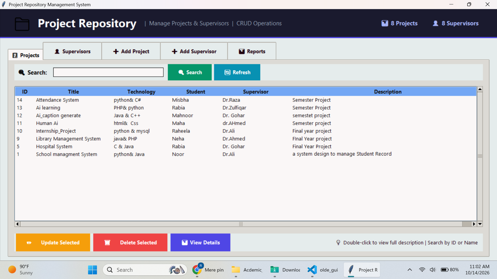
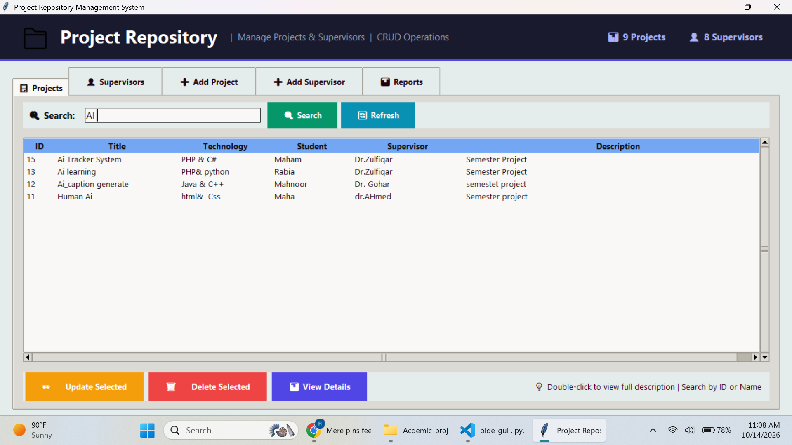
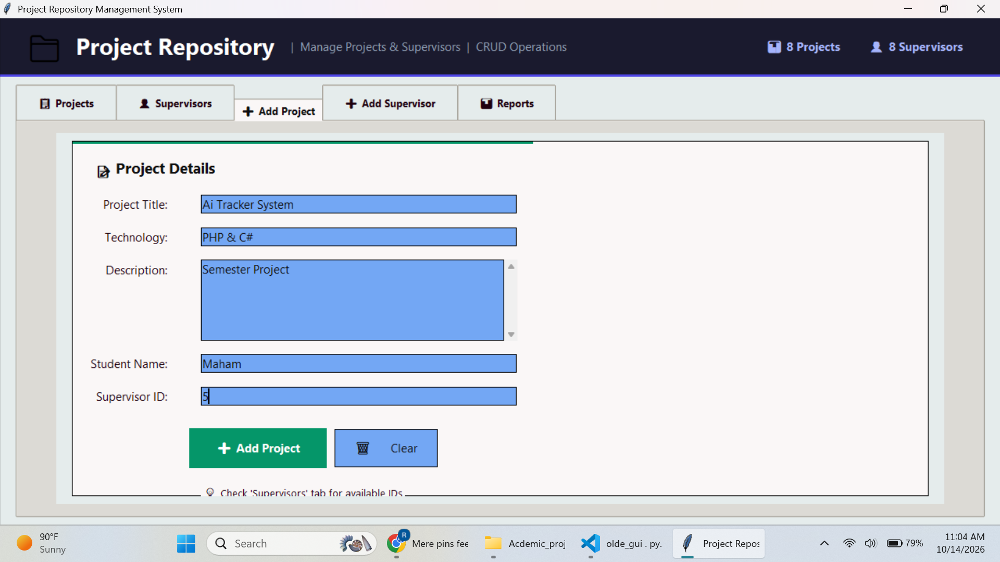
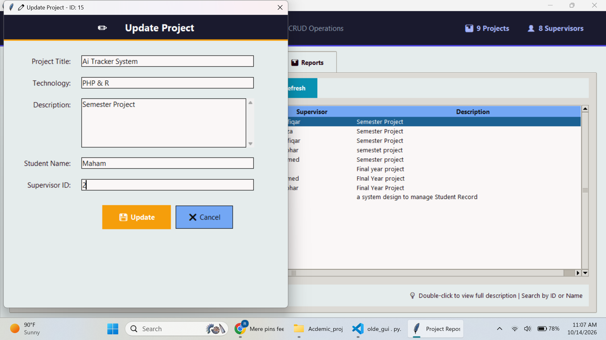
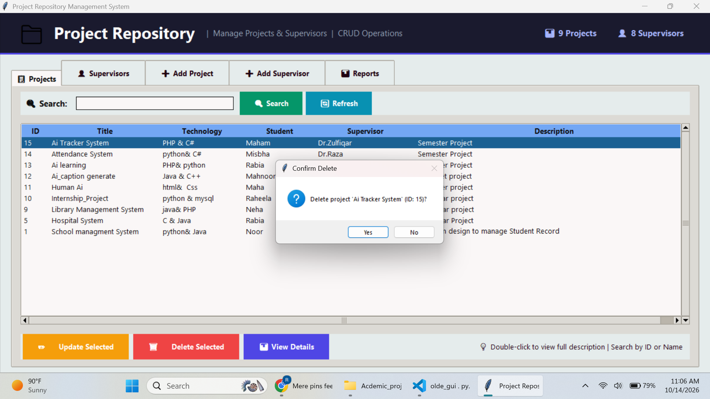
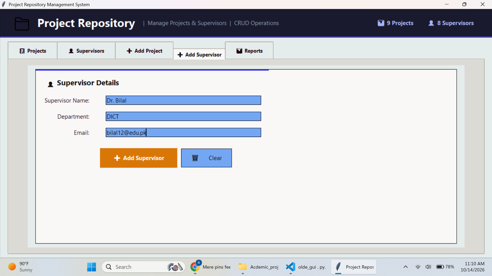
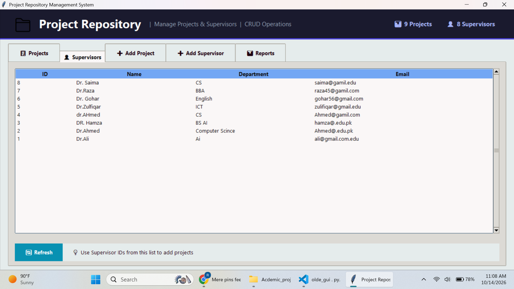

# 📁 Project Repository Management System


A comprehensive desktop application built with Python and MySQL to manage academic projects and supervisors efficiently. This system provides a clean, modern GUI to handle CRUD operations, generate reports, and track project assignments.

> **⚠️ Note:** This repository is a **showcase only**. The complete source code is a premium project and is not available publicly. 

---

## 📸 Project Screenshots & Features

Here is a detailed look at the application interface:

### 1. Dashboard & Project List
Manage all your projects in one place. View project ID, title, technology, student name, assigned supervisor, and description.


### 2. Search Functionality
Quickly find any project by searching using its ID, Title, Technology, or Student Name.


### 3. Add New Project
A clean and simple form to add new projects. It includes validation to ensure all fields are filled correctly.


### 4. Update Project Details
Easily update existing project information. The form automatically loads the current data for editing.


### 5. Delete Confirmation
A safe delete feature with a confirmation dialog box to prevent accidental data loss.


### 6. View Project Details
Double-click any project to view its complete details in a separate popup window.


### 7. Manage Supervisors
Add new supervisors with their Name, Department, and Email. Email validation is built-in to prevent invalid entries.


### 8. Supervisors List
View a complete list of all registered supervisors along with their IDs (used for assigning projects).


### 9. Generate & Save Reports
Generate detailed text reports for Projects, Supervisors, or the Full System, and save them directly to your computer.


## ✨ Key Features

*   **Modern Dashboard:** Clean UI with a real-time count of Total Projects and Total Supervisors.
*   **Project Management (CRUD):**
    *   Add, Update, Delete, and View projects.
    *   Search projects by ID, Title, Technology, or Student Name.
*   **Supervisor Management:**
    *   Add new supervisors with Name, Department, and Email.
    *   View a complete list of registered supervisors.
*   **Data Validation & Duplicate Check:**
    *   Email format validation for supervisors.
    *   Prevents adding duplicate projects (checks Title, Tech, and Student).
    *   Ensures the assigned Supervisor ID actually exists in the database.
*   **Reporting System:**
    *   Generate detailed text reports for Projects, Supervisors, or the Full System.
    *   Export and save reports directly to your computer as `.txt` files.
*   **Professional UI/UX:**
    *   Color-coded tabs and buttons for intuitive navigation.
    *   Responsive layout with scrollbars for large datasets.
    *   Real-time status bar for user feedback.

## 🛠️ Tech Stack

*   **Language:** Python 3.x
*   **GUI Framework:** Tkinter & Ttk
*   **Database:** MySQL
*   **Libraries:** `mysql-connector-python`, `datetime`, `re`, `os`

---

## 💰 How to Get the Source Code?

This is a **premium project** designed for educational and commercial use. The complete source code, database schema (`.sql` file), and full documentation are available for purchase.

**You will get:**
1. Complete Python Source Code (`main.py`, `database.py`).
2. MySQL Database File (`.sql`).
3. Step-by-step Setup Guide (PDF).
4. Full Documentation.

**To purchase the complete source code, please contact me directly:**

*   
*   **Email:** [aiprogrammer45@gmail.com]
*  


---

## 🚀 How to Run (For Buyers)

1. **Install Python:** Ensure Python 3.x is installed on your system.
2. **Install Dependencies:**
   ```bash
   pip install mysql-connector-python
